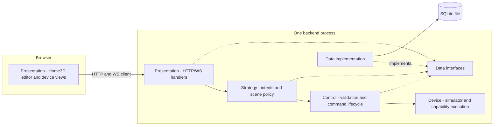

# Smart Home architecture · v0.2

**Week 10 proposal.** One household, one browser application, one backend, and persistent storage. The first review scenario is a resident placing a lamp in a room and controlling it from the floor plan. The [team plan](project-plan-zh.md) defines the household problem and the four team roles. Match those roles to the actual team members for the review. See the [course checklist](checkpoint-checklist-en.md) for instructor requirements.

## Technology decision

[ADR 0001](adr/0001-pascal-week-13-demo.md) records the editor choice for the integrated Week 13 demo. The Home3D design below describes the original Route B baseline.

Adapt **Home3D** as the Presentation layer using the course guide's route B. Keep its **React, Vite, Zustand, and Three.js** stack. Use a single **FastAPI** backend, **SQLite** for the single-host demo, **HTTP** for requests and snapshots, and **WebSocket** for live updates. Implement a simulated device adapter inside the backend for repeatable success, rejection, delay, and timeout. The adapter interface also gives the team a place to add hardware.

Home3D provides wall editing, furniture placement, selection, rotation, undo/redo, and 2D and 3D views of the same design. SQLite simplifies one-command startup for a single backend process. A deployment with multiple independent backend instances would require revisiting persistence and event distribution. Performance is unmeasured.

The instructor approved Home3D for this course project. Starting reference revision: `392bb92cbb5cf13a673795193aadb5e9c62b5bfe`. Credit Home3D in the project README and retain upstream notices when integrating it. The team owns server persistence, the configurable catalog and capabilities, device control and state, and scene strategy. [Home3D repository](https://github.com/lohith9/Home_View)

- Connect `useDesignStore` save/load to the backend. The upstream implementation saves `{version, objects}` in browser `localStorage`. Use the server as the authority for saved layouts and retain unsaved edits in the browser store.
- Feed the furniture sidebar with templates from the backend. Link each controllable placed item to a stable `deviceId`. A generic representation and metadata-driven controls cover new types that use existing capability kinds.
- Keep live device state in a separate browser store keyed by `deviceId`. The map, list, and controls read from that same projection. Geometry and undo history stay in the editor store.
- The [Week 13 interface contract](contracts/week-13/README.md) defines the shared layout fixture, Home3D coordinate mapping, and lamp HTTP and WebSocket messages.

## Five layers and deployment

Solid arrows inside the backend show call direction. Dotted arrows show use or implementation of a Data interface. Presentation's browse and layout routes use the permitted Data interface for persistence. Every device control request enters through Strategy, including a manual command. The Device module has no application-store dependency.

At runtime, a device report returns through the Device interface Control called. Control commits confirmed state and history before publishing an event. Presentation forwards the event to connected clients. Each browser keeps one normalized projection of server state shared by the floor plan, list, and panel. On reconnect it obtains a fresh snapshot.

| Layer | Owns |
| --- | --- |
| Presentation | Browser input, rendering, wire payload parsing, and status display. |
| Strategy | Maps a manual intent to a command plan. Evaluates scene conditions and computes actions, delays, and adaptive climate policy. Reads needed context through Data interfaces. |
| Control | Validates plans against known capabilities, coordinates dispatch and retries, tracks outcomes, and records and publishes state. |
| Device | Executes capability operations and reports results, using device identifiers and capability values. |
| Data | Catalog, plans, configuration, command results, current state, and history. Supplies persistence, query, and transaction interfaces. |

## Key interfaces

| Caller → owner | Contract |
| --- | --- |
| Browser → Presentation | `POST /api/devices/{deviceId}/commands` accepts a capability, requested value, and `requestId`. `POST /api/scenes/{sceneId}/runs` starts a scene. Acceptance creates a pending operation that can be queried. |
| Presentation → Strategy | Submit a manual intent or trigger a named scene. Strategy returns the command or scene-run reference once Control accepts the plan. An unmet scene condition is a Strategy outcome. |
| Strategy → Control | Submit an ordered command plan with target device, capability, typed value, and optional delay for each operation. Strategy supplies any explanation. Control exposes per-command outcomes. |
| Control → Device | Execute `{deviceId, capability, value, requestId}` and report the applied value or rejection. Control owns the deadline. The simulator exposes deterministic failure and delay behavior through this same interface. |
| Control → Data | Atomically record a confirmed change and append its history entry. Maintain command outcomes separately from device state. |
| Presentation → Browser | Fetch a snapshot and subscribe to command outcomes and confirmed-state events. State updates include device ID, capability, value, server timestamp, and revision. |

An item template describes dimensions and its illustration. A device type declares its capabilities. Capability metadata defines the key, value type, range or allowed values, unit, and writability. Layout instances reference their templates and may link to a device instance with a stable ID. A versioned floor-plan document stores room geometry, walls, item positions, and rotation. The Week 13 layout uses the editor's centimeter coordinates and clockwise degrees. Existing supported capability kinds render through metadata-driven controls.

## First end-to-end feature

A resident draws a room, places a lamp, saves, reloads, and presses **On**. Strategy creates one command. Control checks that the lamp has writable `power`, asks the simulator to apply it, then persists and publishes the confirmed value. At each stage, the browser shows the last confirmed state and the current command outcome.

| Situation | Observable acceptance check |
| --- | --- |
| Saving and reloading | Wall and lamp position and rotation match the saved layout. |
| Confirmed success | Map, list, and panel converge on On with an updated timestamp. History contains the confirmed state change. |
| Rejection or timeout | The displayed value remains the last confirmed state. The command displays its rejection or timeout. A timeout leaves the physical outcome uncertain. A later trustworthy device report can update state independently. |
| Repeated HTTP request | Resubmitting the same request ID with the same payload returns the existing outcome, with one logical command. Reuse of the ID with a different payload is rejected. Automatic device replay requires idempotent operations or adapter support. |
| WebSocket reconnect | A fresh snapshot restores the current view. Older state revisions cannot overwrite a newer projection. |

## Build order and evidence

1. **Week 10:** Explain the project goal, five responsibilities, diagram arrows, and the lamp interfaces. Present the household scenario, confirm the four named owners, and explain the simulator-first approach.
2. **Week 13:** Implement the room-and-lamp feature first. Expand the catalog and state views around it. Demonstrate map creation, placement, control, and state query. Record success and timeout evidence.
3. **Final:** Complete F1–F5. Add Home, Away, and Sleep scene plans, dynamic temperature policy, and progress. Decide which optional feature to demonstrate after estimating baseline work. The climate formula and offline-sensor fallback need their own decisions.

| Requirement | Primary implementation areas |
| --- | --- |
| F1 · Household management | Presentation inventory and imports/exports, Data inventory and coordinates |
| F2 · Catalog | Data templates and capability metadata, Presentation generic editor, Device capability descriptions |
| F3 · Floor plan | Presentation Home3D editor, Data layout documents |
| F4 · Device control | Presentation status, Strategy manual intents, Control lifecycle, Device execution, Data state/history |
| F5 · Scenes | Strategy policy, Control scheduled execution and outcomes, Device operations, Data scene configuration and history |

The guide's targets of 30 FPS with up to 50 furniture items, a first screen within 3 seconds, and LAN command latency at most 1 second are acceptance targets. The Week 10 design has no runtime measurements.
